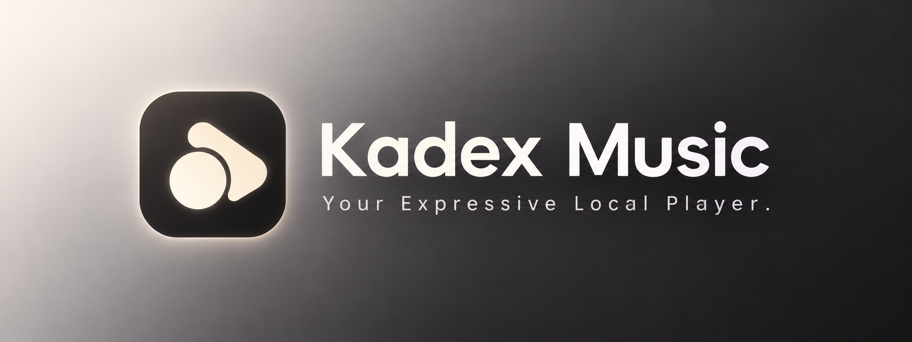
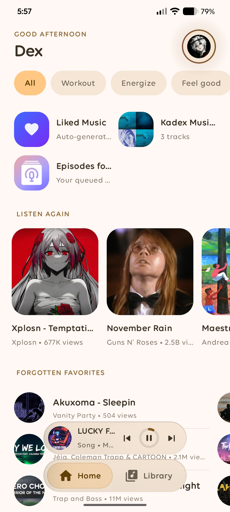
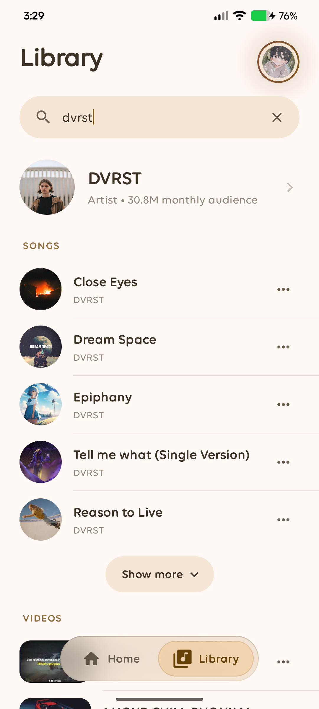
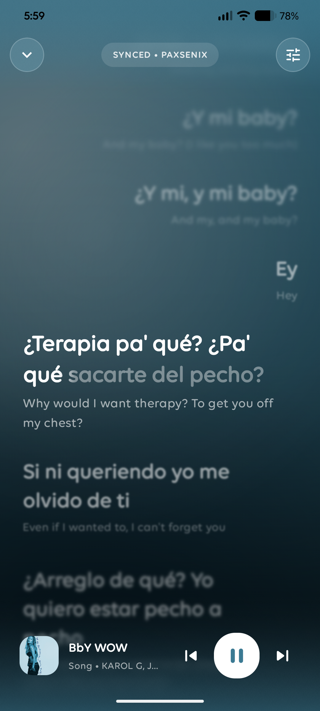
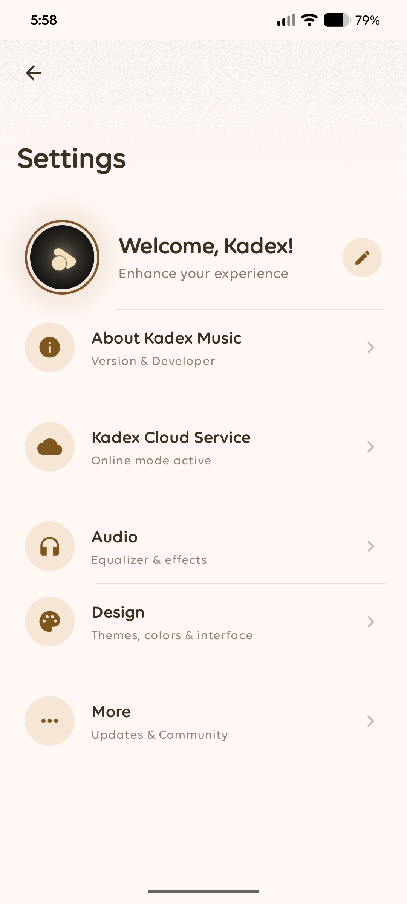

  

<h1 align="center">Kadex Music</h1>

  <strong>Your Expressive Local Player.</strong>

  A modern Android music player combining local playback, online streaming, intelligent library management, and extensive personalization.

  Built with <strong>Kotlin</strong>, <strong>Jetpack Compose</strong>, and <strong>Material 3 Expressive</strong>.

  
  
  
  
  

  <a href="#about">About</a> •
  <a href="#features">Features</a> •
  <a href="#online-integration">Online Integration</a> •
  <a href="#screenshots">Screenshots</a> •
  <a href="#technology">Technology</a> •
  <a href="#acknowledgements">Acknowledgements</a> •
  <a href="#development">Development</a> •
  <a href="#project-status">Status</a> •
  <a href="#license">License</a>

---

# About

Kadex Music is an expressive Android music player designed to bring local music and online music services together in one application.

Originally developed as a local music player, Kadex has evolved into a more comprehensive music experience, combining offline playback, online streaming, library synchronization, lyrics, music videos, and extensive interface customization.

The project focuses on providing a seamless experience between local and online music while maintaining performance, flexibility, and a distinctive visual identity.

One player. Two music experiences.

---

# Features

🎵 Music Library

- Local music discovery and organization.
- Online music library integration.
- Artists, Albums, and Songs browsing.
- Album artwork support.
- Progressive content loading.
- Separate online and offline library management.
- Organized search results.

🎧 Music Player

- Local and online music playback.
- Play / Pause and track navigation.
- Queue management.
- Background playback.
- System media controls.
- Crossfade effects.
- Internal equalizer.
- Dynamic player appearance based on album artwork.

☁️ Cloud Integration

- YouTube Music account integration.
- Online music streaming.
- Account-based music data access.
- Synchronized playlists and liked songs.
- Online and offline playback management.
- Dedicated online library experience.
- Streaming queue integration.

📝 Lyrics

- Online lyrics providers.
- Local ".lrc" support.
- Offline lyrics loading.
- Syllable-based animations.
- Lyrics personalization.
- Multiple formats and presentation options.
- Quick Menu integration.
- Application-language support.

🎬 Music Videos

- Music video playback within Kadex.
- Video availability based on the currently playing track.
- Support for official or relevant alternative videos when available.
- Integrated video playback controls.
- On-demand initialization to reduce unnecessary resource consumption.

🔎 Online Search

Dedicated search categories for:

- Artists: More accurate artist results.
- Music: Music tracks only.
- Videos: Music videos only.

Music and Video categories display their five most popular results by default, with an Expand option to browse additional results.

📂 Playlists

- Local playlist creation and management.
- Online playlist integration.
- YouTube Music playlist synchronization.
- Add and remove tracks.
- Playlist playback.
- Local favorites and online liked songs management.

🎨 Interface & Personalization

- Material 3 Expressive design.
- Dynamic and adaptive colors.
- Album artwork-based gradients.
- Real in-app blur effects.
- Dark and Light themes.
- Solid themes with Dynamic Colors disabled.
- Smooth animations and transitions.
- Alternative player designs.
- Custom application fonts.
- Seekbar customization.
- Text and interface personalization.

⚙️ Setup & Updates

- Redesigned initial setup experience.
- Language selection.
- Welcome and permissions screens.
- What's New information.
- Online / Offline mode selection.
- Integrated update checking.
- In-app APK downloading.
- Manual installation permission handling.
- Automatic cleanup of downloaded update packages after opening the installer.

---

# Online Integration

Kadex Music uses an external YouTube Music integration to provide access to online music functionality.

This integration enables features such as:

- Account connection.
- Online music browsing.
- Streaming playback.
- Playlist and liked-song synchronization.
- Artist and album discovery.
- Online search.
- Music video availability.

Online functionality depends on the availability and compatibility of the external service.

Note: Kadex Music is an independent project and is not affiliated with, endorsed by, or officially associated with YouTube, YouTube Music, or Google.

---

# Performance & Optimization

Performance is an important part of Kadex Music's development.

Current optimization approaches include:

- Progressive loading to prevent unnecessary resource consumption.
- On-demand initialization of music video playback.
- Cache-based media preloading.
- Separate handling of online and offline content.
- Architecture and resource management improvements.

Current development measurements

Metric| Approximate value
Universal APK| 66 MB
ARM64 APK| 49 MB
ARMv7 APK| 47 MB
Installed universal application| 173 MB
Initial user data| 56 MB
Initial cache| 1 MB
Typical RAM usage during streaming| 160 MB

These values are development measurements and may vary depending on device architecture, Android version, playback conditions, and downloaded content.

Storage consumption may increase as the user downloads music or additional resources.

---

# Screenshots

  
  
  
  
  

  <em>Home • Library • Player • Lyrics • Settings</em>

---

## Technology

Technology| Purpose
Kotlin| Main programming language
Jetpack Compose| Declarative UI toolkit
Material 3 Expressive| Design system
AndroidX| Android components
MediaStore| Local music discovery
Android Media APIs| Media playback
YouTube Music integration| Online music functionality

---

## Design Philosophy

Kadex Music follows four core principles:

- Expressive: A distinctive visual identity built around modern Android design.
- Adaptive: Interface colors and surfaces respond to album artwork and device settings.
- Unified: Local and online music coexist within one listening experience.
- Efficient: Features are designed with resource consumption and performance in mind.

The goal is not simply to create another music player, but to provide a complete and cohesive music experience.

---

## Acknowledgements & Dependencies

Kadex Music builds upon the work of several open-source projects and independent developers.

Special thanks to the following projects and their contributors for their work, tools, libraries, and inspiration:

- "Team NewPipe" (https://github.com/teamnewpipe/) — For their contributions to the NewPipe ecosystem.
- "JunkFood02" (https://github.com/junkfood02/) — For their open-source projects and contributions.
- "Soundly by jonysc12" (https://github.com/jonysc12/Soundly) — For their work and contribution to the Android music player ecosystem.

Their work has helped support the development and evolution of Kadex Music.

Respect and credit belong to the original authors and contributors.

---

## Development

Kadex Music is developed using a mobile-first Android development workflow.

The project explores native Android development through Kotlin and Jetpack Compose, with its core development process carried out directly from a mobile device.

From interface design to feature implementation, Kadex continues to evolve through experimentation, iteration, and continuous improvements.

  <strong>Designed on a phone. Built from scratch.</strong>

---

## Project Status

Kadex Music is currently under active development.

The project has evolved significantly from its original local-player concept, and new features, improvements, and optimizations are continuously being implemented.

Some functionality may still be experimental or subject to change.

The priority is to consolidate the existing features, improve stability, and deliver a reliable and complete music experience.

---

## License

Closed-source software.

Kadex Music is proprietary software.

The source code, assets, designs, and all original content associated with this project are the property of their respective owners.

You may not copy, modify, redistribute, republish, sell, or use any part of this project without explicit written permission.

All rights reserved.

© 2026 Korvex

---

# Developer

  <strong>Korvex</strong> 
  <a href="https://github.com/dexvoid-git">@dexvoid-git</a>

  <em>Creating, experimenting, and building something expressive.</em>

  Made with ❤️ using Kotlin and Jetpack Compose.

